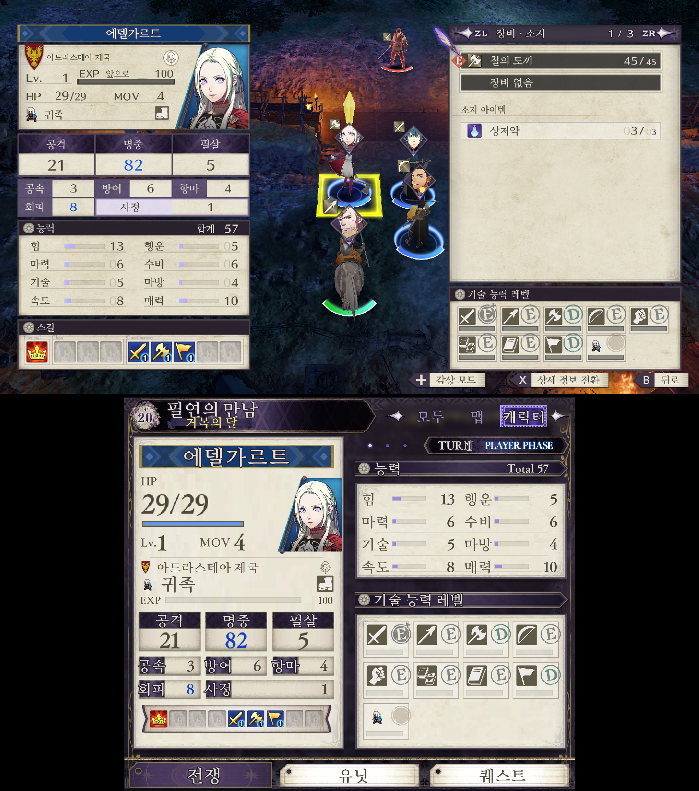
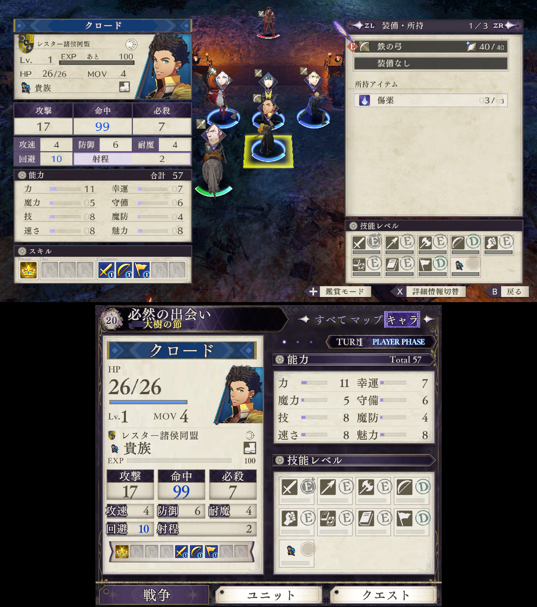
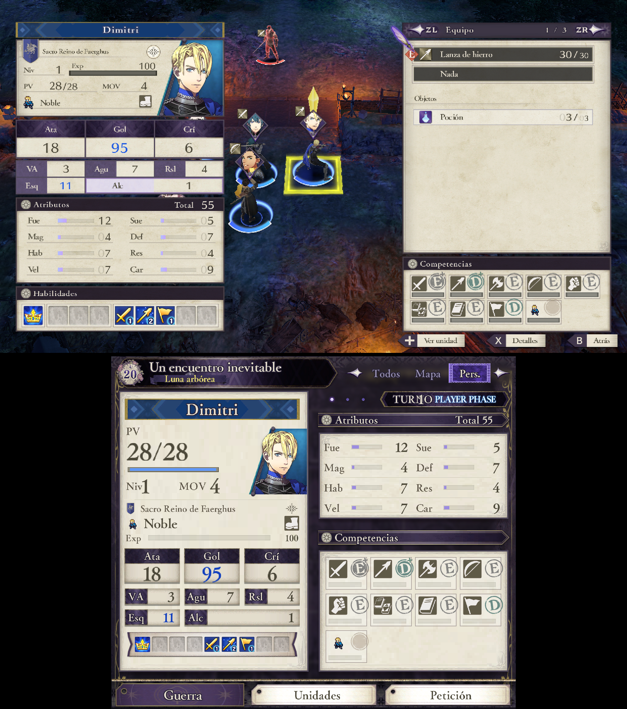
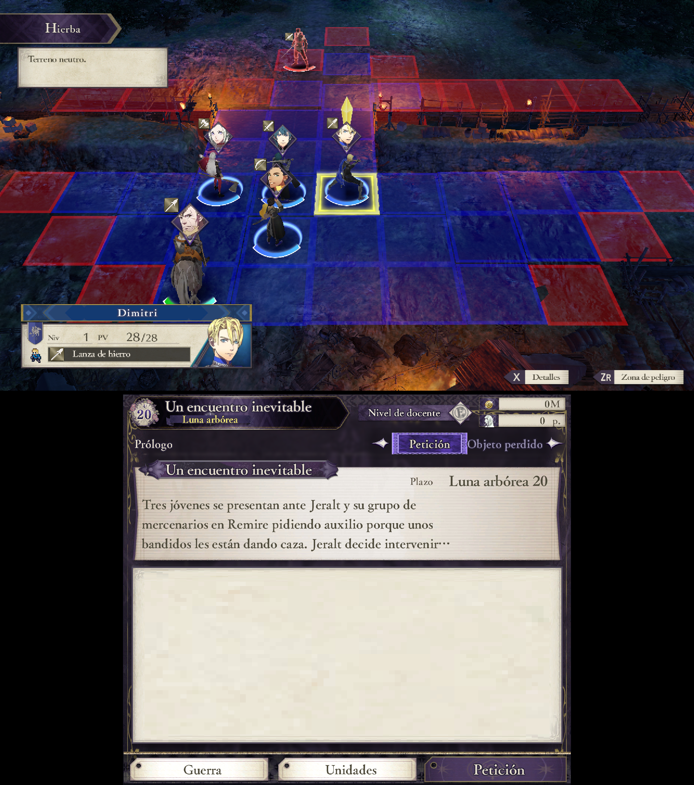
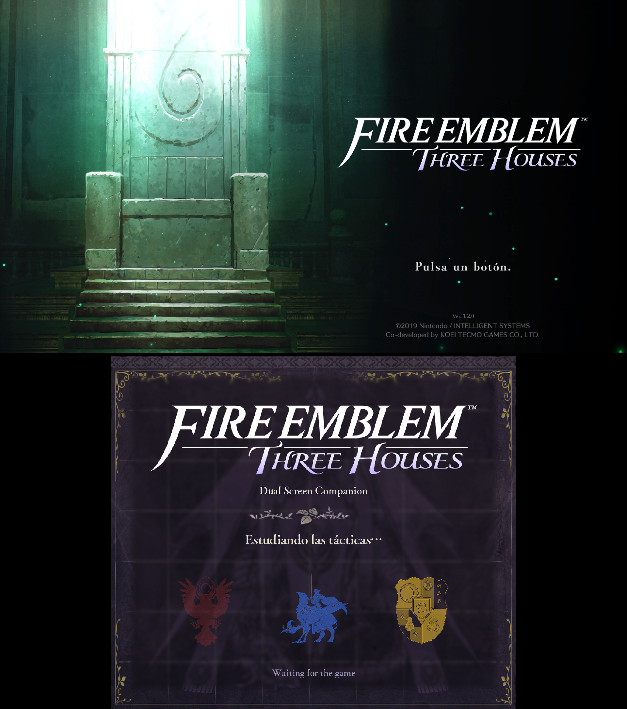
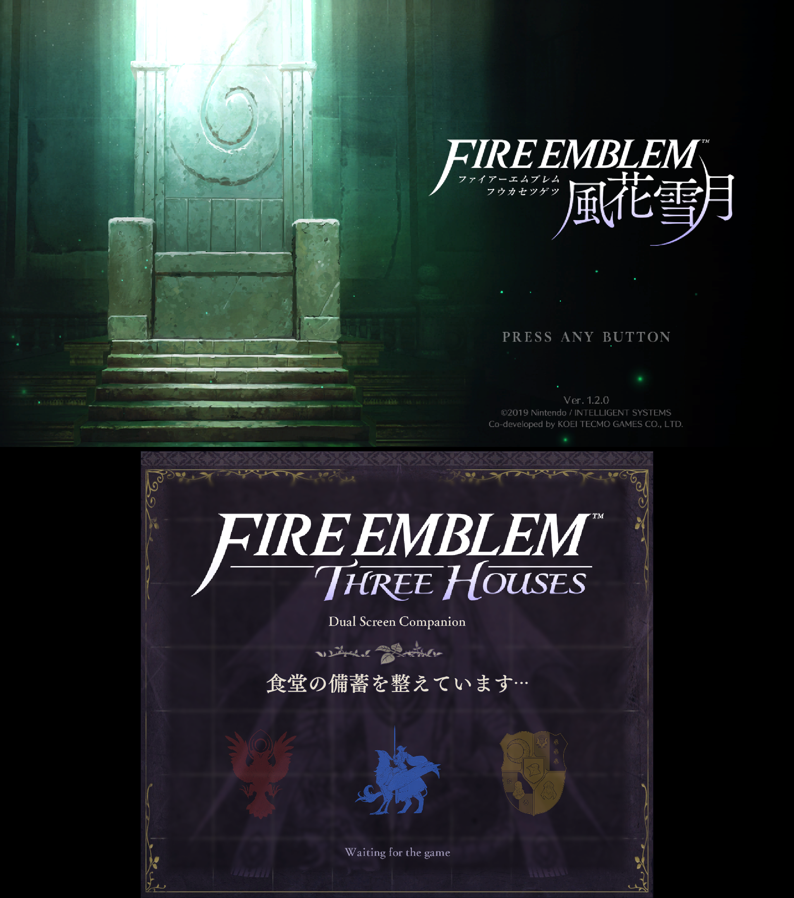

# Fire Emblem: Three Houses — 한글/다국어 컴패니언

`010055D009F78000` · 게임 버전 1.2.0 · Eden Duo 1.3.4 (런타임 18 이상)에서 확인

원 컴패니언(1.0.0)은 라틴 글꼴만 읽어서, 한국어 게임에서는 세컨드 스크린의 이름·직업 같은 글자가 빈칸이었습니다.
이 모드는 게임에 이미 들어 있는 한국어·일본어·중국어 글꼴을 읽어서 해결하고, 고정 문구도 게임 언어를 따라가게 합니다.

> 바탕: [`igawa6/eden-duo-companions`](https://github.com/igawa6/eden-duo-companions) 커밋 `fc0f85e`.
> 출처와 라이선스는 [../../NOTICE.md](../../NOTICE.md)를 보세요.

## 패키지 두 종류

| 파일 | 라벨 문구 | 언어 |
|---|---|---|
| `…-1.1.0-ko.dsmod.zip` | 한국어로 **고정** | 한국어 전용 (게임 언어 감지 불필요) |
| `…-1.1.0-multilang.dsmod.zip` | 게임 언어를 **따라감** | 일본어·영어·프랑스어·독일어·이탈리아어·스페인어·한국어·중국어(간체/번체) |

두 패키지의 모듈(`.so`)과 폰트 설정은 같습니다. 설치: Eden Duo의 게임 **Add-ons → Install → Dual screen mods**.
기존 컴패니언은 먼저 지우세요.

## 무엇을 바꿨나

1. **CJK 글리프**: 게임 데이터의 언어별 글꼴 아틀라스(LINKDATA 71/73/74/75)와 글자 코드표(76/79/78/80)를
   실행 중 읽어, 라틴 글꼴에 없는 글자(한글, 가나, 한자)를 채웁니다. 한글은 언어와 상관없이 항상 넣고,
   한자는 게임 언어의 글꼴을 씁니다(같은 한자도 모양이 다름).
2. **1줄 페이지 아틀라스**: 글꼴 이미지를 글자 1줄(52px, 78글자) 조각으로 나눠 호스트 캐시(32 MiB)에 맞춥니다.
   처음에는 4줄 조각이어서 한 화면의 한글이 캐시를 넘쳐 글자가 나왔다 안 나왔다 했습니다.
3. **언어 감지**: 게임이 가진 언어 값은 참고용으로만 쓰고, 게임 메모리에서 읽은 단어 5개를 12개 언어의 `msgdata`
   문구와 비교해 실제 언어를 찾습니다. 찾은 언어로 폰트와 라벨을 바꿉니다.
4. **라벨**: 매니페스트의 고정 영어 라벨(`label` 위젯 1501곳)을 `ui.l.*` 키에 연결합니다. 게임 용어 71개는 게임의
   `msgdata`에서 그 언어의 단어를 읽어 쓰고(게임 문구는 저장소에 없음), 게임에 없는 모듈 고유 문구 39개는
   `tools/own.py`의 번역을 씁니다.

## 스크린샷

위쪽이 게임 화면, 아래쪽이 컴패니언(세컨드 스크린)입니다. 모두 안드로이드의 Eden Duo 1.3.4에서 찍었고,
라벨·이름·직업이 게임 언어를 따라 나옵니다.

| 한국어 (전투) | 일본어 (전투) | 스페인어 (전투) |
|:---:|:---:|:---:|
|  |  |  |

| 스페인어 (퀘스트) | 스페인어 (로딩) | 일본어 (로딩) |
|:---:|:---:|:---:|
|  |  |  |

화면 속 그림과 문구는 게임의 것이며 각 소유자의 자산입니다. 이 저장소의 파일에는 포함되지 않고,
스크린샷만 설명용으로 둡니다.

## 확인 상태

- 한국어, 일본어 및 나머지 지원 언어는 안드로이드(Eden Duo 1.3.4)에서 화면으로 확인했습니다.
- 모듈 고유 문구 39개의 번역은 AI의 도움으로 쓴 것이라 어색한 표현이 있을 수 있습니다. 고칠 곳은 `tools/own.py`입니다.

## 알려진 한계

- 한글의 글자 폭은 게임 데이터에서 찾지 못해 고정값(한글 51px, 그 외 52px)입니다.
- 중국어·일본어는 한자가 많아(각 5000자 안팎) 글자가 많은 화면에서는 글자 조각이 캐시를 넘칠 수 있습니다.
- 리눅스용 `.so`도 같은 소스로 빌드했지만 안드로이드에서만 실제 확인했습니다.
- `ko` 패키지에는 한국어 폰트에 없는 `・`(U+30FB)을 `·`(U+00B7)로 바꿔 넣었습니다.

## 빌드

1. 업스트림을 받아 패치를 적용합니다.
   ```sh
   git clone https://github.com/igawa6/eden-duo-companions.git && cd eden-duo-companions
   git checkout fc0f85e
   git apply ../Eden_Duo_Mode/mods/fire-emblem-three-houses/patches/0001-fe3h-cjk-glyphs-and-language-labels.patch
   ```
2. [Eden Duo v1.2.0](https://github.com/igawa6/eden-duo/tree/v1.2.0)의 `src/core/mods`, `externals/bc_decoder` 헤더와
   fmt 12.1.0, nlohmann/json 3.12.0, zstd, lz4 소스가 필요합니다. `tools/build.sh`는 Docker(Debian 13, GCC 14,
   Android NDK r28c)에서 리눅스·안드로이드(`arm64-v8a`) 모듈을 빌드하는 스크립트입니다.
3. 매니페스트는 원 패키지(1.0.0)의 `manifest.json`을 입력으로, `tools/gen_labels.py`(다국어)와
   `tools/gen_ko.py`(한국어 고정)가 만듭니다. `tools/pack.py`가 해시를 갱신하고 zip으로 묶습니다.

`tools/`의 스크립트는 작성자의 작업 폴더(`H:\EdenDuo`) 구조를 가정합니다. 경로는 스크립트 위쪽 상수를 고치세요.
`tests/`의 `*.cpp`는 PC에서 도는 확인용 테스트입니다(실제 게임 코드표를 `tools/`의 `dump_probe.py` 등으로 뽑아서 사용).
